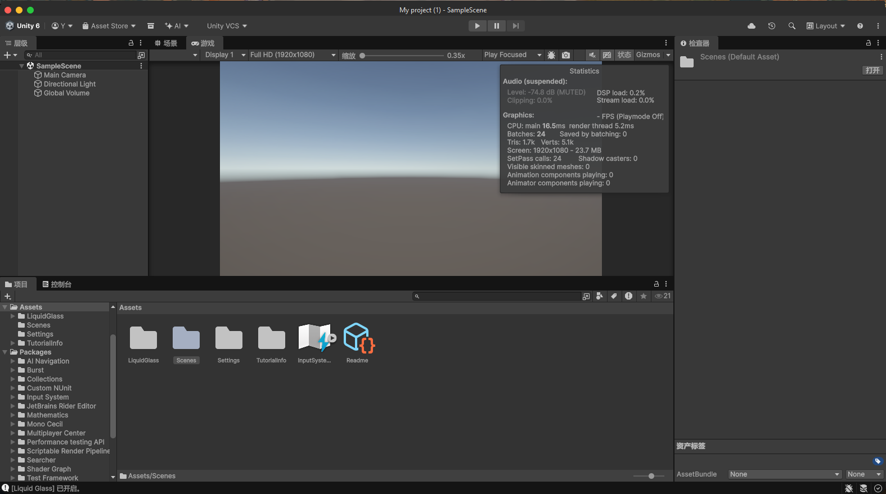

# macOS Chrome for Unity Editor


**English** | [简体中文](README.zh-CN.md)

[Overview](#about) • [Screenshots](#screenshots) • [Download](#download--installation) • [How It Works](#how-it-works)

**A Unity Editor extension that gives the Unity navigation bar on Windows a macOS look.**

A red-yellow-green traffic-light title bar, a centered project name, rounded corners — plus a menu bar moved to the **very top of the screen**.

- [Screenshots](#screenshots)
- [About](#about)
- [Download & Installation](#download--installation)
- [Getting Started](#getting-started)
- [How It Works](#how-it-works)
- [System Requirements](#system-requirements)
- [Project Structure](#project-structure)
- [License](#license)

---

## Screenshots

<p align="center">
  
</p>

<p align="center">
  What it looks like in practice: the macOS-style menu bar drawn by the plugin sits at the very top of the screen, and below it is the Unity Editor window with the custom title bar applied.
</p>

---

## About

On Windows, Unity uses the standard Win32 window look. This project replaces it with a macOS style, so people used to macOS feel more at home — **without sacrificing any native window behavior**.

| Capability | Description |
|---|---|
| macOS-style title bar | Red-yellow-green traffic lights on the left (Close / Minimize / Maximize), centered project name, rounded corners on all four sides; the traffic-light colors follow the window activation state and turn gray when unfocused |
| Top-of-screen menu bar | Unity's top-level menus are moved to the very top of the screen (a separate always-on-top window). Clicking opens a **fully custom-drawn** dark dropdown menu with cascading submenus, checkmarks, separators, and hover highlighting |
| Adjustable appearance | Menu bar background (Auto / Transparent / Light / Dark / Custom), dropdown menu color scheme (Follow System / Light / Dark / Custom) |
| Native window behavior | Dragging, double-click to maximize, Aero Snap, eight-direction edge resizing, `Win + Arrow keys`, and `Alt + Space` are all preserved |
| No install, easy uninstall | The on/off state is stored in `EditorPrefs` and is automatically re-applied after a domain reload or editor restart; it never touches the Unity installation directory — delete the folder to uninstall |

All sizes adapt via `GetDpiForWindow`, so high-DPI displays need no extra configuration.

---

## Download & Installation

**Windows only** (pure Win32 non-client area manipulation). Windows 10 2004+ / Windows 11 recommended.

| Method | File | Description |
|---|---|---|
| **One-click import (recommended)** | [`unity-macos-chrome-0.2.0.unitypackage`](dist/unity-macos-chrome-0.2.0.unitypackage) | Double-click it, or in the editor choose `Assets > Import Package > Custom Package...`, select the file, check everything → Import. It installs to `Assets/LiquidGlass/`; if that directory already exists, it updates in place |
| Unzip and drop in | [`unity-macos-chrome-0.2.0.zip`](dist/unity-macos-chrome-0.2.0.zip) | Unzip to get `LiquidGlass/`, then drag the whole folder into your project's `Assets/` |
| UPM tarball | [`com.liquidglass.macos-chrome-0.2.0.tgz`](dist/com.liquidglass.macos-chrome-0.2.0.tgz) | `Window > Package Manager > + > Add package from tarball...` |
| Local package | `package.json` | `Add package from disk...`; or add a line to `Packages/manifest.json`: `"com.liquidglass.macos-chrome": "file:../../unity-macos-chrome"` |
| Git URL | Repository URL | `Package Manager > + > Add package from git URL...` |

> **Note** — The import package contains no asmdef, so its scripts compile into `Assembly-CSharp-Editor`; installed via UPM it uses a separate assembly, `LiquidGlass.Editor`. **Do not install both copies at once**, or you'll get duplicate type definitions (`CS0101`). When switching from Assets to UPM, delete the old `Assets/LiquidGlass` first.

Once installed, wait for Unity to finish compiling and a `Tools > Editor Chrome` menu will appear. Follow the instructions below to enable it.

---

## Getting Started

### Menus

| Menu | Purpose |
|---|---|
| `Tools > Editor Chrome > macOS Title Bar > Enable` | Enable the macOS title bar + top-of-screen menu bar |
| `Tools > Editor Chrome > macOS Title Bar > Disable` | Disable and fully restore the native appearance |
| `Tools > Editor Chrome > Restore Native Frame (fix broken window)` | **First aid**: forcibly restore the window in one click if its frame / client area gets messed up |
| `Tools > Liquid Glass > Settings...` | Settings panel: whitelist, menu bar background, dropdown color scheme, and more |
| `Tools > Liquid Glass > Run Self Test` | Self test — dumps window / menu / capture state to the Console |
| `Tools > Liquid Glass > Capture Window (PNG)` | Captures a screenshot of the editor window |

The on/off state is stored in `EditorPrefs` (key prefix `LiquidGlass.`) and is **automatically re-applied after a domain reload or editor restart** — no need to click it every time.

### Configuration

The `Liquid Glass` menu at the far right of the top menu bar, or the `Settings...` panel, lets you adjust:

- **Menu bar background**: Auto / Transparent / Light / Dark / Custom
- **Dropdown menu color scheme**: Follow System / Light / Dark / Custom
- **Process whitelist**: add / remove entries, or edit them directly in the text field in the settings panel

### Focus Whitelist

The menu bar window uses `WS_EX_NOACTIVATE`, so clicking it does not activate Unity. But if the foreground window belongs to a **code editor** (VS Code, Rider, Cursor...), the plugin by default does not steal the foreground — otherwise a single click on the menu would kick you out of your IDE.

The trade-off: when the foreground is occupied by another program, keyboard navigation in the popup (Esc / arrow keys) does not work, but the mouse works as usual.

The default whitelist already covers common IDEs (`Code.exe`, `cursor.exe`, `rider64.exe`, `devenv.exe`, `sublime_text.exe`, `WindowsTerminal.exe`...). Entries can be written as `Code.exe` or `code`, case-insensitive.

---

## How It Works

In one sentence: **remove the native title bar, make the non-client area "unowned," then draw it yourself.**

1. `SetWindowLongPtr(GWL_STYLE)` removes `WS_CAPTION` while keeping `WS_THICKFRAME | WS_SYSMENU | WS_MINIMIZEBOX | WS_MAXIMIZEBOX`;
2. `WM_NCCALCSIZE` pushes the client area's top edge down, reserving a 28px title bar strip;
3. On that strip, the traffic lights, title, and rounded corners are drawn manually, and `WM_NCHITTEST` reports it as `HTCAPTION` — dragging, double-click to maximize, and Aero Snap are still handled natively by the system;
4. The menu bar is a separate `WS_POPUP` topmost layered window, shown only while Unity is the foreground process; the dropdown menus are fully custom-drawn, and selecting an item sends `PostMessage(WM_COMMAND, id)` back to Unity — **not a single line of menu logic needs to be rewritten**;
5. `WM_GETMINMAXINFO` shifts the maximized area down, so a maximized window stops below the on-screen menu bar.

About 7,800 lines of C#. For details, see [How It Works](docs/macos-chrome.md).

---

## System Requirements

| Item | Status |
|---|---|
| Operating system | **Windows only**. Mostly usable on Win10 2004+; full experience (rounded corners, acrylic, dark title bar) on Win11 |
| Unity version | Tested on **6000.3.8f1**; `package.json` declares `2021.3` and above |
| Render pipeline | Irrelevant — it only manipulates the Win32 window and never touches rendering |
| Platform modules | No extra modules needed; pure editor scripts, never packaged into builds |
| Multiple monitors | The menu bar only covers the display that hosts Unity's main window |

---

## Project Structure

```
unity-macos-chrome/
├─ Editor/
│  ├─ MacTitleBar.cs            ★ macOS-style title bar
│  ├─ MacMenuBar.cs             ★ Top-of-screen menu bar + custom-drawn dropdown popups
│  ├─ FreezeCurtain.cs          Snapshot curtain covering the NC area during domain reloads
│  ├─ NativeMethods.cs          Win32 / DWM / GDI declarations
│  ├─ UnityMainWindow.cs        Locates the Unity main window handle
│  ├─ LiquidGlassSettings.cs    Settings persistence + settings panel
│  ├─ LiquidGlassBootstrap.cs   Lifecycle and menu entries
│  ├─ GlassDiagnostics.cs       Self test / screenshot tools
│  ├─ LiquidGlass.Editor.asmdef
│  └─ Styles/GlassTheme.uss     Theme stylesheet (optional)
├─ docs/
│  ├─ macos-chrome.md           How it works (English, primary doc)
│  ├─ macos-chrome.zh-CN.md     How it works (Chinese)
│  └─ img/                      Screenshots and diagrams
├─ dist/                        The three distribution packages
├─ tools/make-unitypackage.py   Packaging script
├─ README.md                    This file (repo front page)
├─ README.zh-CN.md              Chinese readme
└─ package.json                 UPM package manifest
```

The two files marked ★ are the core.

---

## License

The approach draws on the custom title bar techniques of Chrome / VS Code / Electron, and on the window and menu bar conventions of macOS.

This project is licensed under the [GNU General Public License v3.0](LICENSE) (SPDX: `GPL-3.0-only`), © 2026 Liquid Glass contributors.
