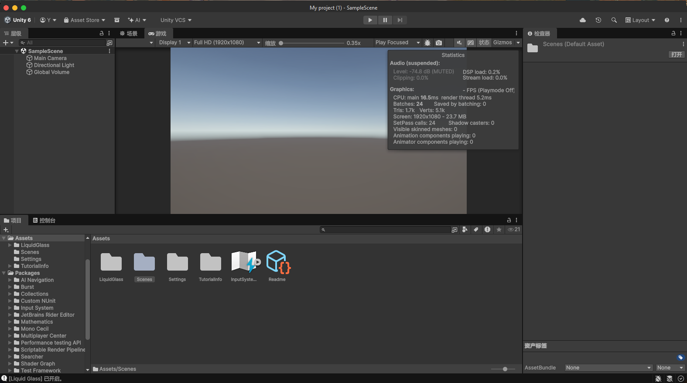

# macOS Chrome for Unity Editor


[English](README.md) | **简体中文**

[简介](#关于) • [截图](#截图) • [下载](#下载与安装) • [工作原理](#工作原理)

**一个 Unity 编辑器扩展：把 Windows 上的 Unity 导航栏换成 macOS 的样子。**

红黄绿圆点标题栏、居中项目名、圆角窗口，外加一条搬到**屏幕最顶部**的菜单栏。

- [截图](#截图)
- [关于](#关于)
- [下载与安装](#下载与安装)
- [开始使用](#开始使用)
- [工作原理](#工作原理)
- [系统要求](#系统要求)
- [项目结构](#项目结构)
- [许可](#许可)

---

## 截图

<p align="center">
  
</p>

<p align="center">
  实际运行效果：屏幕最顶部是插件绘制的 macOS 风格菜单栏，下方是套用了自定义标题栏的 Unity 编辑器窗口。
</p>

---

## 关于

Unity 在 Windows 上是标准的 Win32 窗口外观。这个项目把它替换成 macOS 风格，让习惯 macOS 的人看着更顺眼，同时**不牺牲任何原生窗口行为**。

| 能力 | 说明 |
|---|---|
| macOS 风格标题栏 | 左侧红黄绿圆点（关 / 最小化 / 最大化）、居中项目名、四角圆角；圆点颜色跟随窗口激活状态，失焦变灰 |
| 屏幕顶部菜单栏 | Unity 的顶级菜单搬到屏幕最顶部（独立置顶窗口）。点开是**完全自绘**的深色下拉菜单，支持级联子菜单、勾选、分隔线和悬停高亮 |
| 外观可调 | 菜单栏底色（自动 / 透明 / 浅色 / 深色 / 自定义）、二级菜单配色（跟随系统 / 浅色 / 深色 / 自定义） |
| 原生窗口行为 | 拖动、双击最大化、贴边分屏（Aero Snap）、四边八向缩放、`Win + 方向键`、`Alt + Space` 全部保留 |
| 免安装、易卸载 | 开关状态存在 `EditorPrefs`，域重载 / 重启编辑器后自动装回；不改动 Unity 安装目录，删掉文件夹即卸载 |

所有尺寸按 `GetDpiForWindow` 自适应，高 DPI 显示器无需额外配置。

---

## 下载与安装

仅支持 **Windows**（纯 Win32 非客户区操作）。推荐 Windows 10 2004+ / Windows 11。

| 方式 | 文件 | 说明 |
|---|---|---|
| **一键导入（推荐）** | [`unity-macos-chrome-0.1.0.unitypackage`](dist/unity-macos-chrome-0.1.0.unitypackage) | 双击，或在编辑器里 `Assets > Import Package > Custom Package...` 选中它，全选 → Import。装到 `Assets/LiquidGlass/`，已有目录时是就地更新 |
| 解压即用 | [`unity-macos-chrome-0.1.0.zip`](dist/unity-macos-chrome-0.1.0.zip) | 解压得到 `LiquidGlass/`，整个拖进项目的 `Assets/` 下 |
| UPM tarball | [`com.liquidglass.macos-chrome-0.1.0.tgz`](dist/com.liquidglass.macos-chrome-0.1.0.tgz) | `Window > Package Manager > + > Add package from tarball...` |
| 本地包 | `package.json` | `Add package from disk...`；或在 `Packages/manifest.json` 加一行 `"com.liquidglass.macos-chrome": "file:../../unity-macos-chrome"` |
| Git URL | 仓库地址 | `Package Manager > + > Add package from git URL...` |

> **Note** — 导入包不含 asmdef，脚本会编进 `Assembly-CSharp-Editor`；通过 UPM 安装则使用独立程序集 `LiquidGlass.Editor`。**不要同时安装两份**，否则会出现类型重复定义（`CS0101`）；从 Assets 换成 UPM 时先删掉旧的 `Assets/LiquidGlass`。

装好后等 Unity 编译完成，菜单里会出现 `Tools > Editor Chrome`，按下面的说明开启即可。

---

## 开始使用

### 菜单

| 菜单 | 作用 |
|---|---|
| `Tools > Editor Chrome > macOS Title Bar > Enable` | 开启 macOS 标题栏 + 屏幕顶部菜单栏 |
| `Tools > Editor Chrome > macOS Title Bar > Disable` | 关闭并完全恢复原生外观 |
| `Tools > Editor Chrome > Restore Native Frame (fix broken window)` | **急救**：窗口边框 / 客户区被搞乱时，一键强制还原 |
| `Tools > Liquid Glass > Settings...` | 设置面板：白名单、菜单栏底色、二级菜单配色等 |
| `Tools > Liquid Glass > Run Self Test` | 自检，把窗口 / 菜单 / 捕获状态打到 Console |
| `Tools > Liquid Glass > Capture Window (PNG)` | 抓取一张编辑器窗口截图 |

开关状态保存在 `EditorPrefs`（键前缀 `LiquidGlass.`），**域重载或重启编辑器后会自动装回去**，不用每次手点。

### 配置

顶部菜单栏最右侧的 `Liquid Glass` 菜单，或 `Settings...` 面板，可以调整：

- **菜单栏底色**：自动 / 透明 / 浅色 / 深色 / 自定义
- **二级菜单配色**（下拉菜单）：跟随系统 / 浅色 / 深色 / 自定义
- **白名单程序**：添加 / 移除，或直接在设置面板里编辑文本框

### 焦点白名单

菜单栏窗口是 `WS_EX_NOACTIVATE`，点它不会激活 Unity。但如果前台是**代码编辑器**（VS Code、Rider、Cursor……），插件默认不会去抢前台 —— 否则点一下菜单就被踢出 IDE 了。

代价是：前台被别的程序占着时，弹层里的键盘导航（Esc / 方向键）无效，鼠标照常可用。

默认白名单已包含常见 IDE（`Code.exe`、`cursor.exe`、`rider64.exe`、`devenv.exe`、`sublime_text.exe`、`WindowsTerminal.exe`……）。条目可以写 `Code.exe` 或 `code`，大小写不敏感。

---

## 工作原理

一句话：**去掉原生标题栏，把非客户区变成「无主」的，然后自己画。**

1. `SetWindowLongPtr(GWL_STYLE)` 去掉 `WS_CAPTION`，保留 `WS_THICKFRAME | WS_SYSMENU | WS_MINIMIZEBOX | WS_MAXIMIZEBOX`；
2. `WM_NCCALCSIZE` 把客户区顶边往下压，空出一条 28px 的标题栏带；
3. 在这条带子上自绘圆点、标题和圆角，并用 `WM_NCHITTEST` 把它报成 `HTCAPTION` —— 拖动、双击最大化、贴边分屏仍由系统原生处理；
4. 菜单栏是独立的 `WS_POPUP` 置顶分层窗口，只在 Unity 是前台进程时显示；下拉菜单完全自绘，选中项通过 `PostMessage(WM_COMMAND, id)` 回传给 Unity，**菜单逻辑一行都不用重写**；
5. `WM_GETMINMAXINFO` 把最大化区域往下挪，让最大化窗口停在屏幕菜单栏下方。

约 7600 行 C#，细节见 [工作原理](docs/macos-chrome.zh-CN.md)。

---

## 系统要求

| 项 | 情况 |
|---|---|
| 操作系统 | **仅 Windows**。Win10 2004+ 基本可用，Win11 完整体验（圆角、亚克力、深色标题栏） |
| Unity 版本 | 在 **6000.3.8f1** 上实测；`package.json` 声明 `2021.3` 及以上 |
| 渲染管线 | 无关，只操作 Win32 窗口，不碰渲染 |
| 平台模块 | 无需额外模块；纯编辑器脚本，不会打进构建产物 |
| 多显示器 | 菜单栏只覆盖 Unity 主窗口所在的那个显示器 |

---

## 项目结构

```
unity-macos-chrome/
├─ Editor/
│  ├─ MacTitleBar.cs            ★ macOS 风格标题栏
│  ├─ MacMenuBar.cs             ★ 屏幕顶部菜单栏 + 自绘下拉弹层
│  ├─ FreezeCurtain.cs          域重载期间盖住 NC 区的快照幕布
│  ├─ NativeMethods.cs          Win32 / DWM / GDI 声明
│  ├─ UnityMainWindow.cs        定位 Unity 主窗口句柄
│  ├─ LiquidGlassSettings.cs    设置持久化 + 设置面板
│  ├─ LiquidGlassBootstrap.cs   生命周期与菜单入口
│  ├─ GlassDiagnostics.cs       自检 / 截图工具
│  ├─ LiquidGlass.Editor.asmdef
│  └─ Styles/GlassTheme.uss     主题样式（可选）
├─ docs/
│  ├─ macos-chrome.md           How it works（英文，主文档）
│  ├─ macos-chrome.zh-CN.md     工作原理（中文）
│  └─ img/                      截图与示意图
├─ dist/                        三种分发包
├─ tools/make-unitypackage.py   打包脚本
├─ README.md                    英文说明（仓库首页）
├─ README.zh-CN.md              本文件
└─ package.json                 UPM 包描述
```

标 ★ 的两个文件是核心。

---

## 许可

思路参考了 Chrome / VS Code / Electron 的自定义标题栏做法，以及 macOS 的窗口与菜单栏规范。

本项目采用 [GNU General Public License v3.0](LICENSE) 授权（SPDX: `GPL-3.0-only`），© 2026 Liquid Glass contributors。

- 允许自由使用、修改和分发，包括商业用途；
- 分发本插件或任何包含 / 基于本插件的衍生作品时，**整体必须以 GPL-3.0 授权并提供完整源代码**；
- 必须保留版权与许可声明、随附 `LICENSE` 全文，并明确标注所做的修改；
- 按「现状」提供，不含任何担保。

若需要把本插件集成到闭源或专有软件中，请另行联系版权持有人取得其他授权。

> `dist/` 下的 `.unitypackage` 与 `.zip` 只含 `Assets/` 资源、不含协议文件；单独分发这两个包时，请一并附上仓库根目录的 `LICENSE`（`.tgz` 已内置）。

> 使用前请知悉：本插件会**子类化 Unity 主窗口的窗口过程**并修改窗口样式。虽然做了域重载保护和急救菜单，仍建议在版本控制干净的工作区里先试。
