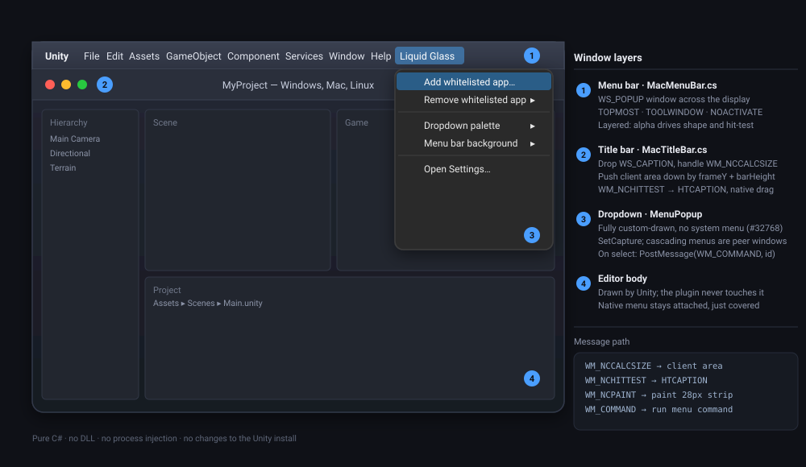

# How it works

[**English**](macos-chrome.md) | [简体中文](macos-chrome.zh-CN.md)

This document explains how the plugin turns the main Unity window into a macOS-style window. It is aimed at people who want to understand or modify the implementation; if you just want to use the plugin, the [README](../README.md) is enough.

The code lives in `Editor/`, and the core is two files: `MacTitleBar.cs` (title bar) and `MacMenuBar.cs` (menu bar). The overall approach follows the custom title bars in Chrome / VS Code / Electron: **remove the native title bar, make the non-client area "ownerless", then draw it yourself.**

  

## Window layers

From top to bottom, the screen has four layers:

| Layer | Host | Notes |
|---|---|---|
| Menu bar | Separate `WS_POPUP` window | Spans the whole display; topmost, layered, non-activating; shown only while Unity is the foreground process |
| Title bar strip | The 28 px carved out at the top of the main window's client area | Custom-painted by the plugin; no longer part of the system non-client area |
| Dropdown | Separate layered window | Created on demand when a menu is clicked; one window per menu level |
| Editor body | The main Unity window's client area | Untouched; Unity lays out and renders as usual |

Sizes adapt via `GetDpiForWindow`: title bar 28 px, menu bar 24 px, corner radius 14 px, traffic-light diameter 12 px (@100% DPI).

## Title bar

The native title bar is drawn by DWM, and anything painted in `WM_NCPAINT` gets covered, so the plugin takes the "remove + yield + custom-paint" route:

1. `SetWindowLongPtr(GWL_STYLE)` removes `WS_CAPTION` while keeping `WS_THICKFRAME | WS_SYSMENU | WS_MINIMIZEBOX | WS_MAXIMIZEBOX`;
2. `WM_NCCALCSIZE` pushes the top of the client area down by `frameY + barHeight`, making room for the title bar;
3. After `WM_NCPAINT` / `WM_NCACTIVATE` / `WM_SIZE` / `WM_SETTEXT`, the strip is repainted (traffic lights, centered title, rounded corners);
4. `WM_NCHITTEST` reports the strip as `HTCAPTION` — dragging, double-click maximize, Aero Snap and eight-way resizing are all handled natively by the system;
5. `WM_NCLBUTTONDOWN` checks whether the click landed on a traffic light and, if so, sends `WM_SYSCOMMAND` (`SC_CLOSE` / `SC_MINIMIZE` / `SC_MAXIMIZE`);
6. `WM_GETMINMAXINFO` shifts the maximize area down so a maximized window stops below the screen menu bar.

Rounded corners are clipped with `SetWindowRgn`, and the colors follow window activation: colored when active, gray when unfocused.

## Menu bar

`MacMenuBar.cs` creates a `WS_POPUP` window with the style `WS_EX_TOPMOST | WS_EX_TOOLWINDOW | WS_EX_NOACTIVATE | WS_EX_LAYERED`. `NOACTIVATE` ensures that clicking the menu does not push Unity out of the foreground.

The dropdown does not use the system menu (class name `#32768`); it is fully custom-drawn:

- it registers its own window class `LiquidGlassMenuPopup`, with a dark background, 1 px border and rounded corners;
- every item is painted by hand: text, checkmark ✓, separators, submenu arrow ▸, hover highlight;
- `SetCapture` takes over the mouse; a cascading submenu is a second popup window of the same class, opened on hover;
- on selection it calls `PostMessage(WM_COMMAND, id)` on the main Unity window — **no menu logic is reimplemented**;
- it closes when you click outside the popup, when the cursor leaves the whole menu chain, when the foreground changes, or on Esc. The decision does not rely on focus, because popups are non-activating windows.

Unity's own `HMENU` stays attached to the window at all times; the plugin only covers it, never removes it — if it were removed, Unity would decide the window has no menu and draw one itself in the client area.

## Lifecycle

| Stage | What happens |
|---|---|
| Startup | `[InitializeOnLoad]` reads `EditorPrefs` (`LiquidGlass.*`) and re-installs if it was enabled last time |
| Domain reload | Before the reload, hooks are detached and the menu bar window is frozen so the managed window procedure does not die with the domain; `FreezeCurtain.cs` covers the non-client area with a snapshot curtain during the reload |
| Shutdown | `Disable` / `Restore Native Frame` restores the original window style and clears the persisted style values |
| Diagnostics | State and timings are written to `Library/mactitlebar.log`; `Run Self Test` prints them to the Console |

The original window style is also stored in `EditorPrefs`, so it can still be restored correctly after a restart or reload.

## Code index

| File | Responsibility |
|---|---|
| `MacTitleBar.cs` | Title bar: style changes, NC message handling, custom painting |
| `MacMenuBar.cs` | Menu bar window, custom dropdowns, menu command forwarding |
| `FreezeCurtain.cs` | Snapshot curtain during domain reloads |
| `UnityMainWindow.cs` | Locates the `UnityContainerWndClass` main window handle |
| `NativeMethods.cs` | P/Invoke declarations for Win32 / DWM / GDI |
| `LiquidGlassSettings.cs` | Settings persistence and settings panel |
| `LiquidGlassBootstrap.cs` | Lifecycle and menu entry points |
| `GlassDiagnostics.cs` | Self-test and window screenshot tools |
