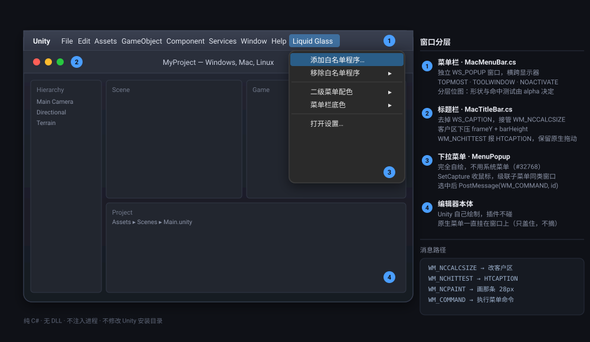

# 工作原理

[English](macos-chrome.md) | [**简体中文**](macos-chrome.zh-CN.md)

这篇文档说明插件如何把 Unity 主窗口换成 macOS 外观。面向想了解或改动实现的人；只想使用插件的话，看 [README 中文版](../README.zh-CN.md) 就够了。

代码集中在 `Editor/` 下，核心是两个文件：`MacTitleBar.cs`（标题栏）与 `MacMenuBar.cs`（菜单栏）。整体思路来自 Chrome / VS Code / Electron 的自定义标题栏：**去掉原生标题栏，把非客户区变成「无主」的，然后自己画。**

  

## 窗口分层

屏幕从上到下是四层：

| 层 | 载体 | 说明 |
|---|---|---|
| 菜单栏 | 独立 `WS_POPUP` 窗口 | 横跨整个显示器，置顶、分层、不激活，只在 Unity 是前台进程时显示 |
| 标题栏带 | 主窗口客户区顶部空出的 28px | 由插件自绘，不再属于系统非客户区 |
| 下拉弹层 | 独立分层窗口 | 点击菜单时按需创建，一个窗口对应一级菜单 |
| 编辑器本体 | Unity 主窗口客户区 | 完全不改动，Unity 照常布局和渲染 |

尺寸按 `GetDpiForWindow` 自适应：标题栏 28px、菜单栏 24px、圆角 14px、圆点直径 12px（@100% DPI）。

## 标题栏

原生标题栏由 DWM 绘制，在 `WM_NCPAINT` 里画的东西会被盖住，所以走「移除 + 让位 + 自绘」的路线：

1. `SetWindowLongPtr(GWL_STYLE)` 去掉 `WS_CAPTION`，保留 `WS_THICKFRAME | WS_SYSMENU | WS_MINIMIZEBOX | WS_MAXIMIZEBOX`；
2. `WM_NCCALCSIZE` 把客户区顶边往下压 `frameY + barHeight`，为标题栏腾出空间；
3. 在 `WM_NCPAINT` / `WM_NCACTIVATE` / `WM_SIZE` / `WM_SETTEXT` 之后重绘这条带子（圆点、居中标题、圆角）；
4. `WM_NCHITTEST` 把这条带子报成 `HTCAPTION` —— 拖动、双击最大化、Aero Snap、四边八向缩放全部由系统原生处理；
5. `WM_NCLBUTTONDOWN` 判断是否点在圆点上，是就发送 `WM_SYSCOMMAND`（`SC_CLOSE` / `SC_MINIMIZE` / `SC_MAXIMIZE`）；
6. `WM_GETMINMAXINFO` 把最大化区域往下挪，让最大化窗口停在屏幕菜单栏下方。

圆角用 `SetWindowRgn` 裁切，颜色跟随窗口激活状态：激活时圆点是彩色，失焦变灰。

## 菜单栏

`MacMenuBar.cs` 创建的是一个 `WS_POPUP` 窗口，样式为 `WS_EX_TOPMOST | WS_EX_TOOLWINDOW | WS_EX_NOACTIVATE | WS_EX_LAYERED`。`NOACTIVATE` 保证点菜单不会把 Unity 从前台挤走。

下拉菜单不用系统菜单（类名 `#32768`），而是完全自绘：

- 注册自己的窗口类 `LiquidGlassMenuPopup`，深色底 + 1px 描边 + 圆角；
- 自己绘制每一项：文字、勾选 ✓、分隔线、子菜单箭头 ▸、悬停高亮；
- `SetCapture` 接管鼠标；级联子菜单是同类的第二个弹层窗口，悬停展开；
- 选中后向 Unity 主窗口 `PostMessage(WM_COMMAND, id)` —— **菜单逻辑一行都不用重写**；
- 关闭时机：点弹层外、光标离开整条菜单链、切走前台、按 Esc。判断不依赖焦点，因为弹层是无激活窗口。

Unity 自带的 `HMENU` 会一直挂在窗口上，插件只盖住它、绝不摘掉 —— 摘掉后 Unity 会判定窗口没有菜单，在客户区自己再画一条。

## 生命周期

| 环节 | 做法 |
|---|---|
| 启动 | `[InitializeOnLoad]` 读取 `EditorPrefs`（`LiquidGlass.*`），若上次是开启状态则自动装回 |
| 域重载 | 重载前主动拆钩子并冻结菜单栏窗口，避免托管窗口过程随域卸载失效；`FreezeCurtain.cs` 在重载期间用快照幕布盖住非客户区 |
| 关闭 | `Disable` / `Restore Native Frame` 还原原始窗口样式，并清除持久化的样式值 |
| 诊断 | 状态与耗时写入 `Library/mactitlebar.log`，可用 `Run Self Test` 输出到 Console |

原始窗口样式额外存一份在 `EditorPrefs`，保证重启或重载后仍能正确还原。

## 代码索引

| 文件 | 职责 |
|---|---|
| `MacTitleBar.cs` | 标题栏：样式修改、NC 消息接管、自绘 |
| `MacMenuBar.cs` | 菜单栏窗口、自绘弹层、菜单命令回传 |
| `FreezeCurtain.cs` | 域重载期间的快照幕布 |
| `UnityMainWindow.cs` | 定位 `UnityContainerWndClass` 主窗口句柄 |
| `NativeMethods.cs` | Win32 / DWM / GDI 的 P/Invoke 声明 |
| `LiquidGlassSettings.cs` | 设置项持久化与设置面板 |
| `LiquidGlassBootstrap.cs` | 生命周期与菜单入口 |
| `GlassDiagnostics.cs` | 自检与窗口截图工具 |
